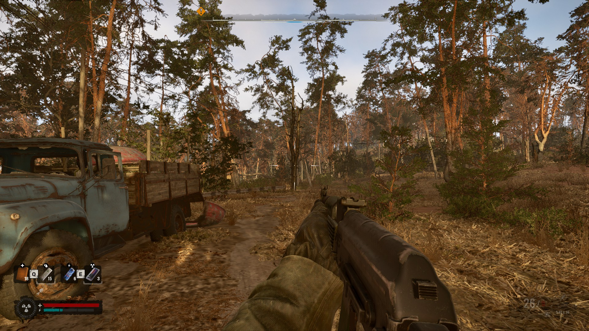
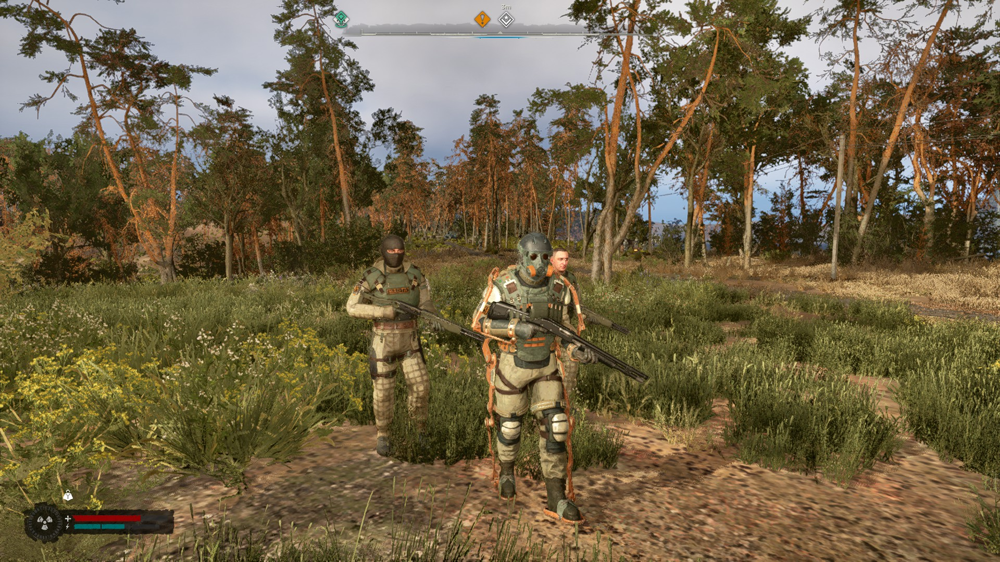

#  S.T.A.L.K.E.R. 2: Heart of Chornobyl
- ✏️ Last modification: 17/11/2026
- 💿 Platform: Steam
- 🛠️ Method: Proton

# Overview
S.T.A.L.K.E.R. 2: Heart of Chornobyl runs out of the box with Proton on Steam.

# Screenshots

